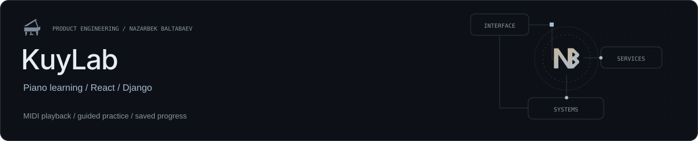

**Learn the piece. Understand the music. Keep your progress.**

[Open KuyLab](https://kuylab.uz/) · [Local development](#local-development) · [Verification](#verification) · [Content and attribution](#content-and-attribution)

A composition-first studio where synchronized MIDI playback, guided lesson stages and personal study tools work together. The experience is available in **Uzbek, Russian and English**.

| Practice | Learn | Continue |
| --- | --- | --- |
| Falling notes, playback speed and arrangement-aware players | Composition lessons, independent exercises and music theory | Saved positions, timestamp notes and account-owned progress |

The implementation separates musical transport and audio behavior from the interface, while a Django backend owns learner state. The repository documents source provenance and third-party rights alongside its code.

Built by [Nazarbek Baltabaev](https://github.com/archon1999).

---

# KuyLab

A composition-first piano learning studio built with Django, React, TypeScript and
MUI. Learn with a falling-note MIDI player, separately authored composition
lessons, general exercises and music theory. Interface languages: Uzbek, Russian
and English; light and dark themes.

Each account has its own favorites, playback positions, learning progress,
preferences and activity statistics. The musical catalog is curated in code;
users do not upload or edit shared content through the website.

Personal timestamp notes open the player at the saved moment and can be edited or
removed with undo. Color-coded learning status is stored per lesson stage and
appears on study cards, filters and statistics. Composition and variant players
retain separate settings; every lesson, exercise, stage and comparison shares one
study-player settings profile per account. Playback positions remain separate.
Still includes eight continuity studies (four
parts, three joins and a full-piece path) alongside its 12 lessons. The independent
curriculum has 48 exercises in 16 families and 24 theory topics, each with a
source-matched MIDI explanation, practice method, pitfalls and a self-check.
Theory includes 49 optional keyboard/ear activities with explanations and sampled
piano audition, including a deeper application task in every topic. Answers are
saved per account: a wrong answer marks a difficulty, and completing every task
marks mastery. Reading or interacting starts an untouched lesson; opening a route
alone does not. The status controls at the top and bottom also allow manual
updates. Activities do not grade physical playing or lock other lessons.

## Structure

- `backend/apps`: learning, scores, studio and activity domains.
- `backend/config/settings`: local SQLite, test SQLite/PostgreSQL, production PostgreSQL.
- `frontend/src/app`: routes, layouts, providers and theme.
- `frontend/src/modules`: domain, application, data-access and UI layers.
- `frontend/src/shared`: transport, localization, UI and playback helpers.
- `frontend/public-site`: prerendered UZ/RU/EN public pages and educational guides.
- `ops`: production deployment, backup and Nginx configuration.

## Local development

Python 3.12, Poetry 2.3.2 and Node 24 LTS are used by CI. SQLite is the local default.

```sh
cd backend
poetry install
poetry run python manage.py migrate
poetry run python manage.py seed_studio
poetry run python manage.py runserver 127.0.0.1:8000
```

In a second terminal:

```sh
cd frontend
npm ci
npm run dev
```

Open http://127.0.0.1:5173 for the public site, then `/studio` to create an account.
For a different local backend port, set `KUYLAB_API_PROXY` before starting Vite.
Local session/CSRF cookie names are isolated from other Django projects.
No default production password or
administrator is shipped. `seed_studio` preserves existing learner state; the
explicit destructive replacement flag is not part of normal setup or deployment.

## Verification

```sh
cd backend
poetry run python manage.py test tests --settings=config.settings.test --noinput
```

```sh
cd frontend
npm run typecheck
npm test
npm run lint
npm run build
```

CI repeats backend tests against PostgreSQL, checks migrations and production
security settings, builds both Docker images, and runs CodeQL. Successful main
commits deploy through a dedicated restricted SSH identity.

## Production

See [deployment and recovery](docs/deployment.md) for Docker, PostgreSQL, Nginx,
DNS/TLS, backup and rollback procedures. Secrets, databases, media and learner
records stay outside Git. Production is configured for `kuylab.uz`.

## Content and attribution

Public pages are generated at build time, including canonical/hreflang links,
Open Graph images, visible educational content and matching JSON-LD. `/robots.txt`
and `/sitemap.xml` list the public site; authenticated studio routes send `noindex`.
Existing composition/player links and legacy query-string bookmarks remain valid.
The service worker keeps public HTML separate from `/studio.html` so visiting a
public guide cannot replace the offline studio shell. No analytics tracker runs
on the public site. `llms.txt` is a content directory, not an indexing guarantee.

When changing public content, edit all three languages in
`frontend/public-site/content.mjs`, update its actual review date, and rebuild.
Google Search Console uses DNS ownership verification; retain its root TXT record.
Submit `https://kuylab.uz/sitemap.xml` and inspect public URLs after deployment.
Check PageSpeed on mobile and desktop; lab scores are separate from field data.

The curated repertoire contains eight compositions: Still, What Is
a Youth, Star, Tears in Your Eyes, My Memory, Premonition, Memories and All in — Soundtrack. All in
has two byte-preserved full-length arrangements, Easy and Hard, in one player
with nine shared lessons and five continuity paths. Variant switching pauses
playback at the same timestamp; settings and resume positions are scoped per
variant. Its optional compact note display abbreviates overlapping long blocks
without changing sound or claiming to reconstruct finger releases. The six
new pieces each include six source-specific lessons and eight continuity studies,
all with five MIDI stages: sparse landmarks, focused layer, complete hands at
60%, complete hands at 80%, and the 100% original. The six current files are the
user's replacement exports without pedal-extended key durations; every original
pitch, attack time and velocity is preserved. Still retains its twelve lessons
and eight studies with their existing three-stage progression.
Every complete-piece path ends with the unchanged supplied original. General
exercises are independently authored examples. Source bytes and
provenance are documented in [the studio notes](backend/apps/studio/README.md).
Composition files and historical reference fixtures do not carry a blanket
open-source redistribution license. Review their provenance before republishing
musical content. Public repository visibility does not change third-party rights.

Piano samples, fonts, MUI and audio worklet notices are in
[third-party notices](frontend/THIRD_PARTY_NOTICES.md) and the app's `/licenses.html`.

Report vulnerabilities privately as described in [SECURITY.md](SECURITY.md).

