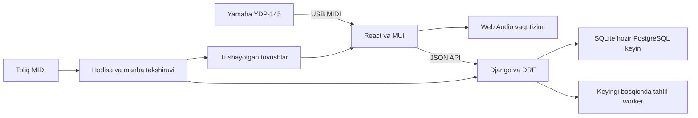

# Individual pianino platformasi uchun texnik tadqiqot

> **Tarixiy texnik tadqiqot — joriy arxitektura yoki versiya kafolati emas.** Quyida avvalgi prototip uchun baholangan import, MusicXML/nota, qurilma va adaptiv oqimlar bor. Ular yangi Still curated studiyasining talabi sifatida o‘qilmasin. Bu nusxadagi dastur versiyalari, xizmat holatlari va xarajatlar qayta tekshirilmagan; amaldagi dependency’lar loyiha manifestlarida. Joriy kontrakt: [studio-contract.md](studio-contract.md); stack, setup va chegaralar: [README](../README.md).

Siz uchun mahsulot — tanlangan kompozitsiyaning to‘liq MIDI’sini Synthesia kabi o‘rganish va shu fayldagi real fragmentlardan alohida nazariya/texnika darslarini olish. Django profil, repertuar, dars va kundalikni saqlaydi; React va MUI player va o‘quv ekranlarini beradi. Nota varaqlarini o‘qish asosiy oqimga kirmaydi. Fizik YDP-145 va ijroning ritm/ifoda baholashi alohida amaliy sinovga muhtoj.

## Stack va versiyalar

2026-yil 11-oktabrda rasmiy Django sahifasi eng yangi seriya sifatida 6.1.2 ni ko'rsatmoqda. Loyihaga 5.2.18 LTS tanlandi: 5.2 seriyasining kengaytirilgan qo'llab-quvvatlashi 2028-yil aprelgacha davom etadi. Bu tanlov asosiy platformani barqaror saqlab, musiqiy vositalarni alohida rivojlantirishga imkon beradi. [Django yuklash va qo'llab-quvvatlash jadvali](https://www.djangoproject.com/download/).

| Qatlam | Prototip holati | Keyingi mahsulotdagi vazifasi |
| --- | --- | --- |
| Python | Ishlatilgan mahalliy runtime 3.12.4 | Yangilangan, qo'llab-quvvatlanadigan patch bilan server |
| Django | 5.2.18 | ORM, migrations, admin, profil va kontent |
| Django REST Framework | 3.18.3 | React uchun JSON API, validatsiya va keyin ruxsatlar |
| django-cors-headers | 4.9.0 | Ikki mahalliy frontend originiga ruxsat |
| React va MUI | `frontend/package.json` va lockfile da aniq versiyalar | Mashg'ulot ekranlari va umumiy komponentlar |
| SQLite | `backend/db.sqlite3` | Mahalliy bitta foydalanuvchi ma'lumotlari |
| PostgreSQL | Hali ulanmagan | Hostingdagi asosiy ma'lumotlar bazasi |
| mido 1.3.3 | Backend dependency | MIDI hodisa va tempo xaritasini parsing qilish |
| MusicXML parser | Backenddagi mavjud moslik API’si | Eski importlarni o‘qiydi; frontendning asosiy importi MIDI |
| music21 | Hali o‘rnatilmagan | Keyingi chuqur musiqiy tahlil uchun nomzod; hozir bounded XML parser ishlaydi |
| Web MIDI va Web Audio | Brauzerdagi nota inputi va player | Fizik qurilma sinovi, timing va ifoda baholashi keyingi bosqich |

Frontend nota testlari Node’ning TypeScript type stripping funksiyasini ishlatadi. README’da Node 22.18+ yoki 24+ tavsiya qilingan; bu funksiya va versiya tarixi [Node rasmiy hujjatida](https://nodejs.org/api/typescript.html) berilgan. Build alohida TypeScript type check’dan o‘tadi.

DRF rasmiy talablari Django 5.2 ni qo'llab-quvvatlaydi. Backend paketlari takrorlanadigan o'rnatish uchun `backend/requirements.txt` da aniq versiyalarga mahkamlangan. [DRF talablari](https://www.django-rest-framework.org/), [DRF release notes](https://www.django-rest-framework.org/community/release-notes/).

## Kompozitsiya va aranjirovkani ajratish

`He’s a Pirate` — kompozitsiya; `Cerullean Pictures (fayldagi kredit), piano MIDI (3)` — aniq o‘quv varianti. Bir nomdagi yuzlab ishlanmalar boshqa registr, faktura va tuzilishga ega. Dars kompozitsiya nomiga emas, shu aranjirovka va o‘zgarmas MIDI versiyasi/hashiga bog‘lanadi.

Tanlangan [to‘liq MIDI](https://bitmidi.com/pirates-of-the-caribbean-hes-a-pirate-3-mid) 11,918 byte, 77.625 soniya, 1,255 nota. `Right Hand` va `Left Hand` trek nomlari manbada mavjud; qo‘l avtomatik pitch threshold bilan uydirilmaydi. Manba metama’lumoti 6/8, F major key-signature va chorak = 200. Yakun D4 + D1/D2 tovushlarini to‘liq ushlab, yopilgan note-off bilan tugaydi. [Audit va attribution](full-source-verification.md).

Asosiy player MIDI’ni klaviaturaga tushayotgan tovushlar sifatida ko‘rsatadi. PDF va MusicXML staff rendereri o‘quvchi uchun majburiy bo‘lmaydi. Avvalgi PDF manbasi tarix sifatida saqlanishi mumkin, faol tanlov yangi to‘liq MIDI bo‘ladi. Eski variant progressi yangi fayldagi bilim daliliga avtomatik ko‘chirilmaydi.

The Sound of Silence, What Is a Youth, All In, Winter Sonata va Naruto xohishlar ro‘yxatida qoladi. OST uchun aniq trek, barcha asarlar uchun to‘liq MIDI varianti tanlanmaguncha ular tayyor individual kurs deb ko‘rsatilmaydi.

## Arxitektura



Chalish paytidagi klavisha hodisasi serverga borib kelishiga bog‘liq emas. Brauzer transport vaqtini yuritadi, tovush va animatsiyani shu vaqtga moslaydi; server source timeline, dars va tarixni beradi. Frontend chegaralari foydalanuvchi ko‘rsatgan `cp_uz` referensi asosida: [app / modules / shared arxitekturasi](frontend-architecture.md). Avtomatik real ijro natijasi API’da hali baholanmaydi.

Bitta foydalanuvchi uchun Redis, Celery, Django Channels va murakkab mikroservislar birinchi bosqichda shart emas. Og'ir audio tahlili yoki MusicXML import navbati paydo bo'lganda worker alohida qo'shiladi. Musiqiy inference kutubxonalarini Django runtime bilan bitta dependency muhitga majburan qo'shish shart emas.

## Yamaha YDP-145 ulanishi

Yamaha qo'llanmasi YDP-145 ning USB TO HOST orqali MIDI va USB audio imkoniyatlarini tasdiqlaydi. Windows da USB audio funksiyasi uchun Yamaha Steinberg USB Driver kerak. Qo'llanma 3 metrdan qisqa AB turdagi USB kabelni ko'rsatadi; USB 3.0 kabelidan foydalanmaslikni aytadi. Uskuna simsiz ulanishni qo'llab-quvvatlamaydi. USB audio interfeysi 44.1 kHz, 24 bit, stereo. [Yamaha YDP-145 qo'llanmasi, 30 va 40-sahifalar](https://data.yamaha.com/files/download/other_assets/6/1538796/ydp165_en_om_single_b0.pdf).

Amaliy tartib: pianinodagi USB Type-B port → kompyuterdagi mos USB port → operatsion tizim MIDI qurilmasini ko'rishi → brauzer ruxsati → saytning haqiqiy input tanlovi. Drayverning joriy OS mosligini o'rnatishdan oldin Yamaha yuklash sahifasida tekshirish kerak. Faqat pianino modeli ma'lum bo'lishi ulanish kompyuterda allaqachon tekshirilganini bildirmaydi. [Yamaha kompyuterga ulanish qo'llanmasi](https://manual.yamaha.com/mi/common/computer/en/computer_en_rm_y0_03.htm).

MIDI klavisha va pedal xabarlarini beradi; u pianinoning audio ovozi emas. USB audio tovushni yozib olish uchun boshqa kanal. Dastlab pianinoning o'z ovozidan foydalanish, brauzerning ikkinchi sintetik ovozini sukutda qoldirish ijroda ikki ovoz va qo'shimcha latency ni kamaytiradi. Bu interfeys bo'yicha tavsiya; uskuna sinovi keyingi integratsiya ishidir.

## Brauzer va ruxsatlar

Web MIDI secure context talab qiladi va foydalanuvchi ruxsatiga bog'liq. Hostingda HTTPS ishlatiladi. Mahalliy `localhost` va loopback originlar secure context sifatida qabul qilinadi; oddiy LAN IP orqali HTTP ochish bir xil emas. Avval `window.isSecureContext` va `navigator.requestMIDIAccess` mavjudligi tekshiriladi. Oddiy nota inputi uchun `sysex:false` yetarli; qurilmani qayta sozlaydigan SysEx bu mahsulotga kerak emas. [MDN requestMIDIAccess](https://developer.mozilla.org/en-US/docs/Web/API/Navigator/requestMIDIAccess), [MDN secure contexts](https://developer.mozilla.org/en-US/docs/Web/Security/Defenses/Secure_Contexts).

| Brauzer | Web MIDI uchun holat | Mahsulot qarori |
| --- | --- | --- |
| Desktop Chrome | API qo'llab-quvvatlanadi | Dastlabki sinov muhiti |
| Desktop Edge | Chromium orqali qo'llab-quvvatlanadi | Windows uchun ikkinchi sinov muhiti |
| Desktop Firefox | 108 dan; site permission add-on sharti bor | Alohida ruxsat UX sinovi |
| Safari va iOS WebKit | MDN jadvalida qo'llab-quvvatlanmagan | Qo'lda yuritiladigan mashg'ulot rejimi |
| Android Firefox | MDN jadvalida qo'llab-quvvatlanmagan | Qo'lda rejim |

Bu jadval API mavjudligi haqida; har bir telefon, adapter va YDP-145 kombinatsiyasini tasdiqlamaydi. [MDN browser compatibility data](https://github.com/mdn/browser-compat-data/blob/main/api/Navigator.json).

Ulangan input yo'q, ruxsat berilmagan, brauzer qo'llamaydi, pianino uzildi va qayta ulandi — turli holatlar. Sayt ular uchun aniq xabar beradi. API mavjudligi yoki ruxsat berilishi o'z-o'zidan `Pianino ulandi` degan natija bo'lmaydi; real input porti va kiruvchi xabar tekshiriladi.

## Metronom va vaqt aniqligi

Production metronomida oddiy `setInterval` tovush chiqishining asosiy vaqt manbasi bo'lmaydi. Web Audio `currentTime` bilan click lar biroz oldindan rejalashtiriladi; chizilgan beat indikatori alohida yangilanadi. Brauzer tab'i fonda qolsa, AudioContext to'xtasa yoki output qurilma almashsa, sessiya holati qayta tekshiriladi. [MDN AudioContext currentTime](https://developer.mozilla.org/en-US/docs/Web/API/BaseAudioContext/currentTime).

`AudioContext.baseLatency` brauzer audio ishlovi kechikishining bir qismini beradi; to'liq MIDI input → eshitilgan ovoz → UI yo'lini bitta universal qiymat bilan tushuntirmaydi. Shu sababli `10 ms kafolat` kabi da'vo berilmaydi. [MDN baseLatency](https://developer.mozilla.org/en-US/docs/Web/API/AudioContext/baseLatency).

Sinov rejasi: click bilan 20–30 nota urish, foydalanuvchining odatiy audio outputi, ichki va tashqi quloqchin, p50/p95 vaqt og'ishi, uzilish va tab holati. Kalibratsiya offseti saqlanadi, baholash tolerantligi BPM va subdivision ga moslanadi. Bu raqamlar o'lchangan natija emas, test dizayni. 6/8 uchun metronom `ikki katta urish` va `olti subdivision` rejimlarini ajratishi kerak. Session BPM kelajakda `beat_unit` bilan saqlanadi; hozir BPM foydalanuvchi qaydi bo'lib, avtomatik reference bilan taqqoslanmaydi.

## MIDI timeline va kontent tahlili

MIDI birlamchi import formatidir. Python tomonda mido 1.3.3 standart faylni o‘qiydi; delta ticklar absolute tick va chorak birliklariga, tempo xaritasi orqali sekundlarga aylantiriladi. Manbadagi tempo o‘zgarishlari saqlanadi. Faqat boshlang‘ich BPM bilan butun asar davomiyligini hisoblash o‘zgaruvchan tempda xato beradi. [Mido MIDI files](https://mido.readthedocs.io/en/stable/files/midi.html).

Har bir hodisa pitch, velocity, track, kanal, boshlanish va key-hold davomiyligini saqlaydi. Sustain CC64 audio ushlab turish davomiyligi sifatida alohida talqin qilinadi: pedal past turgani uchun ekrandagi klavish bosilgan holatda abadiy qolmasligi kerak. Note-on velocity 0 note-off hisoblanadi. Bir pitch qayta bosilishi, akkord, turli kanallar va fayl oxirida pedalning past qolishi tekshiriladi.

Qo‘l manbada yozilgan track nomidan olinishi mumkin; nomlanmagan ko‘p instrumentli MIDI’da trackni qo‘lga xaritalash foydalanuvchi tanlovi bo‘ladi. Drum kanali piano darsiga qo‘shib yuborilmaydi. MIDI barmoqlash yoki tana harakatini kodlamaydi. Literal key-signature va metr mavjud bo‘lsa beriladi; fayl nomidan D minor yoki 6/8 taxmin qilinmaydi.

Parcha tahlili aynan source note IDlari va vaqt oralig‘ida bajariladi: qo‘l tarkibi, takroriy ritm, melodik masofa, bir vaqtdagi tovushlar va registr almashishi. Dars shu faktni nazariya va qisqa amaliy qadam bilan bog‘lab, o‘sha player fragmentiga qaytaradi. Hosil qilingan vaqt oynalari bosma nota takt raqamlari deb ko‘rsatilmaydi.

MusicXML parseri mavjud backend API mosligini saqlaydi. Frontend MIDI importi va tushayotgan tovushlar bilan ishlaydi; OSMD va PDF reader joriy frontenddan olib tashlangan.

## Individual dars yaratish jarayoni

1. Kompozitsiya, aranjirovkachi, manba ID va foydalanuvchi xohlagan ijro belgilanadi. To'plam bo'lsa avval trek tanlanadi.
2. Ochiq yuklanadigan to‘liq MIDI olinadi, manba/provenance qayd etiladi va boshidan finalgacha hodisalar tekshiriladi.
3. Asar forma va frazalarga ajratiladi; repeat, pickup, takt raqami, meter va tempo map tekshiriladi.
4. Sizning qisqa diagnostik ijroingiz olinadi: qaysi fragment, qanday temp, qanday xato, nazariya tushunchasi va qo'l qulayligi.
5. Nazariya va texnika darsi shu MIDI fragmentidagi real tovushlardan olinadi va alohida dars sahifasida beriladi. Barmoqlash qo‘l o‘lchami va harakatga mos o‘qituvchi bilan tekshiriladi.
6. Darsga aniq chiqish mezoni qo'yiladi: masalan, tanlangan bo'lakni belgilangan tempda qayta chalish va ritmni mustaqil sanash. Keyingi kun tekshiruvi orqali eslab qolish ko'riladi.
7. Dars tasdiqlangan score revision bilan saqlanadi. Nota o'zgarsa eski session mosligi saqlanib, yangilash alohida bo'ladi.

Bu mahsulotdagi pedagogik qoidalar bo'yicha taklif. LLM o'quv izohini o'zbekcha yozish, diagnostika savoli va original mashqning qoralamasiga yordam beradi. Takt, nota, akkord va barmoqlashni manbasiz to'ldirmaydi. Nazariy izohni MusicXML orqali tekshirish mumkin, musiqiy talqin va qo'l harakatini ustoz tasdiqlaydi. Birinchi shaxsiy mahsulotda aynan shu tekshiruv kontent sifatining asosiy qismi.

## MIDI baholashning chegarasi

MIDI inputdan pitch, note-on, note-off, velocity va pedal ma'lumoti olinishi mumkin. Baholash uchun kutilgan nota hodisalarini real ijro bilan moslashtirish kerak: akkordni bir necha millisekund farq bilan bosish, takrorlar, o'tkazib yuborilgan nota, to'xtash, ritardando va qayta boshlash hisobga olinadi. `Kutilgan keyingi nota = bosilgan nota` algoritmi o'rta darajadagi pianino uchun yetarli bo'lmaydi.

Mahsulot qarori: avval qisqa tanlangan loop va berilgan tempo uchun cheklangan matcher; keyin score following. Pitch, timing, continuity va velocity balansini alohida ko'rsatish. Dastlabki diagnostikada bir qo'lga ajratilgan topshiriq foydali, chunki bitta MIDI kanaldan kelgan nota avtomatik chap yoki o'ng qo'lni ishonchli isbotlamaydi.

MIDI texnikani to'liq ko'rmaydi: qaysi barmoq bosgani, bilak tarangligi, gavda va tovushning musiqiy sifati uchun boshqa kuzatuv kerak. Dashboarddagi `dars bajarildi`, foydalanuvchi qulaylik bahosi va o'lchangan nota aniqligi alohida evidence turiga ega bo'ladi. Hozirgi API faqat `user_reported` sessiya qaydini saqlaydi.

## Audio tahlili keyingi tajriba bo'lishi kerak

Pianino uchun Onsets and Frames tadqiqoti alohida nota boshlanishi va davomiyligi modellarini birlashtirgan. Spotify Basic Pitch ham polyphonic audio-to-MIDI yo'lini beradi va bitta instrument bilan yaxshiroq ishlashini aytadi. Bular tayyor individual ustoz yoki ishonchli 100 foiz nota bahosi emas. [Onsets and Frames tadqiqoti](https://arxiv.org/abs/1710.11153), [Spotify Basic Pitch](https://github.com/spotify/basic-pitch).

Basic Pitch repo Python mosligi ro'yxatida 3.7–3.11 ni ko'rsatmoqda; bizning Python 3.12 muhitiga tekshirmasdan dependency qilib qo'shilmagan. Keyingi tajribada alohida runtime/container va model litsenziyasi tekshiriladi. USB audio yozuvi mikrofonning xona shovqinidan qulayroq kirish bo'lishi mumkin, ammo pedal, akkord va asarning o'zgaruvchan tempi baribir o'z ma'lumotimizda baholanadi. Sayt avval audio yozuvni tinglash va o'zini kuzatish uchun ishlatadi; avtomatik grading ilmiy sinovdan keyin.

## Litsenziya va kontent saqlash

Kutubxonaning ochiq litsenziyasi ichiga yuklangan musiqa uchun huquq bermaydi. OSMD joriy repo BSD-3-Clause, VexFlow MIT, music21 kodi BSD. music21 corpusidagi har bir asar/kodlashning alohida cheklovi bo'lishi mumkin. [OSMD litsenziyasi](https://github.com/opensheetmusicdisplay/opensheetmusicdisplay/blob/develop/LICENSE), [VexFlow litsenziyasi](https://github.com/vexflow/vexflow), [music21 litsenziya va corpus izohi](https://music21.org/music21docs/about/about.html).

BitMidi ochiq Download orqali original MIDI faylini beradi va o‘zini ko‘ngillilar yig‘gan arxiv sifatida ta’riflaydi. Fayldagi Cerullean Pictures va Walt Disney copyright yozuvlari saqlanadi. Ochiq yuklash mavjudligi CC yoki tijorat qayta tarqatish litsenziyasi deb belgilanmaydi. Ushbu nusxa foydalanuvchi so‘ragan shaxsiy lokal o‘quv loyiha uchun olingan. [Manba auditi](full-source-verification.md), [original attribution](../backend/learning/reference_assets/bitmidi-pirate/ATTRIBUTION.md).

Amaliy huquq yozuvi: original kompozitsiya, ishlanma, nota fayli va ijro audio/video huquqlari alohida; manba, litsenziya dalili, tekshirilgan sana, nashr hududi va ruxsat doirasi saqlanadi. Shaxsiy o'quv yozuvi private bo'ladi. Bu kontent jarayoni uchun talab; katalogdagi har bir asar uchun universal huquq xulosasi emas.

## Amaldagi ma'lumotlar modeli

| Entity | Saqlanadigan asosiy ma'lumot | Muhim bog'lanish |
| --- | --- | --- |
| Profile | Ism, Yamaha YDP-145, 88 klavish, kundalik daqiqa, maqsad | Mahalliy bitta o'quvchi |
| Composition | Nom, muallif metama'lumoti, kategoriya, navbat/faol holat | Bir nechta aranjirovka uchun ota |
| Arrangement | Aniq variant, manba, aranjirovkachi, rights/workflow, meter, beat unit | Composition ga FK |
| PracticePlan | Qoralama/tayyorlik holati, mazmun, demo belgisi | Arrangement va Profile |
| PracticeTask | Tartib, nazariya/texnika/asar, vaqt, instruktsiya, mezon | Plan ga FK |
| PracticeSession | Aniq sekund yoki daqiqa, BPM, 1–5 qulaylik, qayd | Profile va Composition |

`Score` o‘zgarmas import versiyasi, format, source URL/provenance, original fayl, SHA-256, normalized hodisalar va alohida qo‘l/parcha belgilari bilan saqlanadi. `LearningLesson`, diagnostika va quiz/amaliy urinishlar hamda `LessonProgress` ta’lim dalillarini saqlaydi. Dars source versiyasi va fragmenti bilan bog‘lanadi; yangi variant eski o‘zlashtirishni avtomatik meros olmaydi. Sessiyaning avtomatik ijro dalili, kalibratsiya va chuqur score-following keyingi ish. Amaldagi API tafsilotlari [teaching-api](teaching-api.md)da.

## Ishlaydigan API

Base URL: `http://127.0.0.1:8000/api/`. Trailing slash ishlatiladi. CORS faqat localhost va 127.0.0.1 uchun 5173/5174 portlariga ruxsat beradi. API joriy prototipda bitta mahalliy profilga xizmat qiladi; login va account izolatsiyasi hali yo'q.

| Method va yo'l | Natija |
| --- | --- |
| GET `overview/` | Profil, repertuar, faol reja, oxirgi 50 sessiya, real jamlanmalar |
| GET `compositions/` | Repertuar ro'yxati |
| POST `compositions/` | Asar, source URL va ixtiyoriy `arrangement_title`; pending aranjirovka hamda demo reja |
| GET `compositions/<id>/plan/` | Tanlangan asarning reja va vazifalari |
| GET/PATCH `profile/` | Instrument, maqsad, kundalik vaqt |
| PATCH `tasks/<id>/` | `{completed:true/false}` foydalanuvchi belgisi |
| GET `sessions/` | Oxirgi 100 qo'lda kiritilgan sessiya |
| POST `sessions/` | Mashg'ulot qaydini doimiy saqlash |

Session yaratish:

```json
{
  "composition": 1,
  "duration_seconds": 1200,
  "bpm": 60,
  "comfort": 3,
  "notes": "Bugungi kichik fragmentni sekin takrorladim."
}
```

`duration_seconds` 1–14400; uning o'rniga `minutes` 0.01–240 yuborish mumkin. Ikkalasi berilsa aniq sekund asos bo'ladi. BPM 20–240 yoki null, qulaylik 1–5. Javob `input_mode=manual`, `evidence=user_reported` bilan qaytadi. `accuracy` maydoni qabul qilinmaydi. 2 sekundlik sessiya 1 daqiqaga aylantirilmaydi: aniq sekund saqlanib, jami daqiqada 0.03 ko'rsatiladi. Nol davomiylik sessiya sifatida saqlanmaydi.

Manbasiz repertuar yozuvi aniq variant tanlashni kutadi; tayyor MIDI deb ko‘rsatilmaydi. He’s a Pirate to‘liq MIDI’iga source hodisalar va vaqt chegaralari bo‘yicha darslar bog‘lanadi. Har darsning fragmenti asosiy playerdan alohida ochiladi. Reja kunlik vaqt, diagnostika, quiz, shaxsiy mashq qaydi va qayta sinov sanasiga qarab hisoblanadi. Boshlang‘ich 30 daqiqa foydalanuvchi tomonidan hali tasdiqlanmagan taxmin.

Yangi dars va import API shartnomalari: [teaching-api.md](teaching-api.md), [scores README](../backend/scores/README.md). `compositions/<id>/curriculum/`, `diagnostic/`, `adaptive-plan/`, `lessons/<id>/quiz/`, `practice/`, `exercise/` va `scores/` ishlaydi. Nota versiyasi yoki tanlangan parcha o‘zgarsa oldingi dars dalili yangi darsning o‘zlashtirishiga ko‘chirilmaydi.

## Hosting va production chegarasi

Django uchun oddiy Python hosting yoki container yo'li tanlanadi; frontend static build bilan beriladi. Render rasmiy Django qo'llanmasi PostgreSQL, production server va environment konfiguratsiyasi yo'lini ko'rsatadi. Keyin private score/audio fayllar uchun object storage va qisqa muddatli access URL qo'shilishi mumkin. [Render Django deployment qo'llanmasi](https://render.com/docs/deploy-django).

Sites hostingidagi Workers muhitini ushbu Django loyihasining tayyor production serveri deb qabul qilmaymiz. Mahalliy prototip Django stack bilan ochiladi; hosting qarori keyingi release ishi. Worker isolate xotirasi 128 MB: og'ir audio inference uchun alohida Python worker tanlash ancha to'g'ri arxitektura. [Cloudflare Workers chegaralari](https://developers.cloudflare.com/workers/platform/limits/).

Internetga chiqarishdan oldingi release ishlariga user account, owner bo'yicha queryset/permissions, CSRF va cookie siyosati, HTTPS, environment secret, DEBUG false, production WSGI/ASGI server, PostgreSQL migration, backup/restore va private asset access kiradi. Django `runserver` production uchun mo'ljallanmagan. Ushbu sozlamalar hali local-only. [Django deployment checklist](https://docs.djangoproject.com/en/5.2/howto/deployment/checklist/).

Hosting xarajati uchun alohida compute, database, media storage/egress va audio worker hisoblanadi. Mahalliy ishlatishda yangi hosting hisobi kerak emas. Bulut tariflari server xotirasi, doimiy ishlash va asset hajmi tanlangach joriy rasmiy tarifdan olinadi; bu hujjatda tekshirilmagan oylik narx va'dasi berilmagan. [Render tarif katalogi](https://render.com/pricing).

## Keyingi ishlar va taxminiy hajm

Quyidagi hajmlar tayyor prototip ustida tajribali full stack dasturchi va part time pianino ustozining taxmini. Bu SLA yoki tasdiqlangan narx emas. Nota huquqini olish va siz bilan diagnostika kutish vaqti hisobga kirmaydi.

| Bosqich | Yakuniy tekshiriladigan natija | Taxminiy mehnat |
| --- | --- | --- |
| Shaxsiy MVP | Login, private tarix, source/workflow, original nazariya darslari, 1 tekshirilgan aranjirovka | 5–10 ish kuni |
| Birinchi asar kontenti | Tanlangan score asosida frazalar, 6–10 dars va sizning diagnostikangiz | Ustoz uchun 1–3 ish kuni; score mavjud bo'lsa |
| MusicXML va MIDI pilot | Render, device/disconnect UX, qisqa loop, kalibratsiya, test ijrolari | 10–20 ish kuni |
| Moslashuvchi ta'lim | Concepts graph, retention tekshiruvi, qayta rejalash, bir necha asarda sinov | 10–20 ish kuni |
| Audio pilot | USB audio yozuv, alohida inference tajribasi, MIDI ground truth bilan solishtirish | 10–20 ish kuni; natija tajribaga bog'liq |

Eng avval katta katalog qurishdan ko'ra siz tanlagan bitta aranjirovkada o'quv loopini tekshirish foydali: nazariya tushunarli bo'ldimi, fragment keyingi kuni saqlanib qoldimi, mashqning asarga ta'siri sezildimi. Shu natija ikkinchi asar uchun kontent va texnik talabni aniqlaydi.

## Backend tekshiruvi

Real migrations yaratildi va mahalliy SQLite ga qo‘llandi. Testlar repertuar va tarixdan tashqari diagnostika, javob validatsiyasi, dars progressi, qayta sinov, nota versiyalari, metr/tonallik moslashuvi hamda xavfsiz MusicXML/MXL importini qamraydi. Yakuniy buyruqlar, sonlar va brauzer dalillari [verification.md](verification.md)da. Uskuna bilan real MIDI hali sinalmagan; dasturiy nota importi va ekran inputi fizik pianino sinovi o‘rnini bosmaydi.
